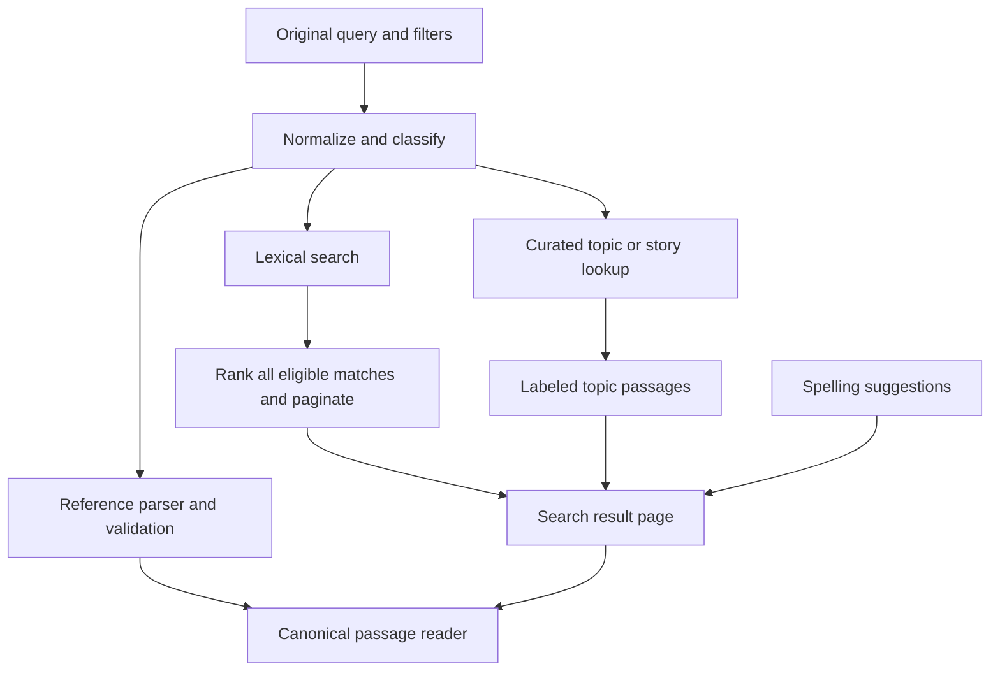

# Good News Bible v2: experience review and delivery plan

Review date: November 15, 2026. Status: proposed work; no application behavior changed by this review.

Implementation update: the first search/reader/Library release is documented in [V2_RELEASE_NOTES.md](V2_RELEASE_NOTES.md). Findings below describe the app at review time; the roadmap also includes follow-up work beyond that release.

## Recommendation

Make v2 excellent at three jobs: **open the right passage, read comfortably, and find it again**. The app already has substantial study and community functionality. Its next release should connect those capabilities through simpler navigation and a more dependable search system.

Prioritize search completeness and reference parsing first, a unified reader second, and personal-library discovery third. Keep the existing PHP, MySQL, and vanilla JavaScript stack. The findings do not establish a need for a framework rewrite or an AI dependency for basic search.

## Review scope and confidence

Inspected the landing page, shared navigation, reader controller and templates, Scripture repository, search-result cards, dictionary, personal library, study entry points, guided notebook, memory practice, authentication return handling, external-translation handling, shared JavaScript/CSS, database definitions, existing tests, and previous product documents.

Evidence comes from source inspection and isolated PHP function probes using the repository's canonical book definitions. Existing authentication-destination and community-visibility tests passed; `node --check assets/js/app.js` passed. A read-only database connection attempt failed, so installed translations, corpus completeness, database query timings, and account-specific behavior could not be verified. The public URL listed in `CLAUDE.md` could not be opened by the web tool. No fresh browser, physical-device, screen-reader, production-account, or usability tests were completed.

Consequently, the search/control-flow findings below are code-backed; visual usability implications are hypotheses to validate. Targets and effort estimates are proposals, not measured improvements. September's `UI_REVIEW.md` records earlier browser checks and their limits; those results were not rerun here.

## What already works and should carry forward

- Reading and Scripture discovery are public. Accounts are introduced for personal saving.
- Home has passage search, daily Scripture, suggested passages, and a device-local Continue reading link.
- The reader supports verse/paragraph modes, translations, comparison, highlights, notes, sharing, context, cross references, and available commentary.
- Search already includes reference recognition, relevance/Bible-order sorting, synonyms, small topic families, spelling correction, and session-based recent searches. Better search means improving this implementation, not adding these concepts from scratch.
- Guided study and Scripture memory already exist in `guided-study.php` and `memory.php`.
- Plans support progress and reflection; sermon notes support richer work. These can remain available without becoming the default reading experience.
- Authentication has an allowlisted return-destination helper and regression coverage. Resource displays already include source attribution and missing-content states.

`FEATURE_OPPORTUNITIES.md` predates several implementations. Translation comparison, the guided notebook, and memory practice should be evaluated as existing features; their original construction estimates are no longer the right starting point. The README's translation list also differs from `supported_translations()`; configured, installed, and working translations need to be distinguished.

## Findings, ordered by impact

Priority definitions: P0 = fix before launching the new search experience; P1 = core v2 usability work; P2 = follow-up after the main flows are dependable. These are product delivery priorities, not security severity ratings.

| Priority | Finding and evidence | Effect on the reader | Proposed response |
| --- | --- | --- | --- |
| P0 | Local keyword retrieval orders candidates by book/chapter/verse and applies `LIMIT 400` before relevance scoring; only 25 ranked rows are returned. See `includes/bible_repository.php:670–764`. | For broad queries, relevant verses later in the Bible can be excluded before ranking. There is no way to continue beyond the returned set. | Retrieve and order across the full matching corpus, with stable pagination. Evaluate New Testament and late-book recall explicitly. |
| P0 | Reference recognition accepts a narrow format, one name and abbreviation per book, and ASCII hyphens. Probes reject `John3:16`, `Jn 3:16`, `John 3:16–18`, and `Psalm 23` with the bundled book catalog. See `includes/bible_repository.php:225` and `scripts/import_translation_helpers.php`. | Common input falls through to keyword search. Home suggests `Psalm 23`; the tools page explicitly suggests an en-dash range the parser rejects. Exact deployed aliases depend on installed book records. | Use one canonical alias/parser service for all entry points; normalize pasted punctuation; validate ranges. Add the app's own examples to regression fixtures. |
| P0 | The parser accepts `John 999:1`, reversed ranges, and zero coordinates without validating the book's structure. | Invalid references become missing-data messages or take a different execution path, leaving users unsure whether they mistyped or content is missing. | Distinguish an invalid reference from a valid passage unavailable in the selected translation. Never silently clamp it to another passage. |
| P0 | Spelling correction runs before keyword retrieval and replaces the query. The UI announces a correction only inside the nonempty-results section and offers no original-query action. See `includes/bible_repository.php:416` and `bible.php:1414`. | A guess can change intent, and an unsuccessful correction can be invisible. Short typos and first-letter errors are also skipped by current rules. | Always search the literal input; offer a reversible “Did you mean …?” action. Preserve the original query even when a suggested query returns no results. |
| P1 | Candidate retrieval and scoring use substring matches alongside broad synonym/topic expansion. An isolated score probe gives `love` 124, `beloved` 112, synthetic `glove` 112, and `charity` 8. See `includes/bible_repository.php:508`. | A substring can receive a phrase bonus. Exact text, word forms, and thematic associations are mixed without result-level explanations. | Rank literal whole-word/phrase matches first; keep related-topic results visibly separate. Treat the probe as a scoring example, not a claim about an actual verse containing “glove.” |
| P1 | Comparison renders a separate two-section template. It excludes the normal `[data-chapter-reader]` article, action bar, and chapter-navigation block. Text-size behavior and reading-position storage depend on that normal reader. See `bible.php:1190`, `bible.php:1452`, and `assets/js/app.js:2277,3765`. | Entering comparison changes which reading controls work. Comparison also lacks per-verse row alignment; independently wrapping columns drift on desktop and become whole-passage sections on mobile. | Render comparison through the same reader model and lifecycle, aligned by canonical verse with explicit gaps. Keep navigation, text settings, resume tracking, and supported save actions available. |
| P1 | Previous/next chapter URLs are built only from the current book's chapter list. Comparison state is omitted from those URLs, mode switches, the authentication return destination, and save redirects. | Reading stops at book boundaries. View choices can disappear during routine actions. | Centralize reader state and URL construction; traverse the canonical book sequence; preserve compatible choices through navigation and login. |
| P1 | Search cards prioritize Share and Open Chapter; “Create Bookmark” actually links to the notes view. Guest bookmark links go directly to `login.php` without a passage return parameter. See `includes/verse-card.php`. | Labels do not consistently predict the action, and sign-in from a search result loses the expected return context. | Use “Read in context,” “Save verse,” “Highlight,” and “Add note” consistently; use the shared return helper everywhere. |
| P1 | Resume stores only the last rendered reader URL and label, on one device. It does not preserve the visible verse while reading a whole chapter. | Returning to a long chapter starts from a less precise location. Exploring a cross reference can overwrite the primary reading destination. | Store a visible-verse anchor and explicit reading/exploration context. Offer “Back to your passage” after a resource detour. Add account sync only after local behavior is stable. |
| P1 | The primary navigation is Home / Bible / Study tools / Plans / More; search has no dedicated destination and personal Library lives under More. Several passage pickers and translation controls coexist in the reader. | Frequent tasks require learning where a feature lives. Multiple controls compete with Scripture. | Test a simpler task-based navigation and one passage picker; provide a dedicated, linkable search screen. |
| P1 | `library.php` fetches all saved verses and notes, and provides view tabs rather than query/filter controls. See `library.php:201` and repository fetch methods at `includes/bible_repository.php:1099,1120`. | A larger personal collection becomes harder to navigate and potentially slower to load. | Add owner-scoped search, book/tag/type filters, sorting, and pagination inside Library. |
| P1 | Shared `search_scripture()` sends recognized references to a local-only query before checking the external provider; the main reader instead fetches external chapters. The sermon endpoint uses the shared function. External spelling vocabulary falls back to KJV. | Main-reader and sermon searches can disagree for an external translation. Availability, sorting, and wording behavior are not consistent across providers. | Introduce a common search/provider contract, explicit provider capabilities, and tests for reference lookup and keyword search through both interfaces. |
| P2 | The dictionary is a small hardcoded collection searched by substring across combined fields. English stop words/stemming are also used for Scripture search although `RVR` is a supported code. | “Words & themes” can suggest broader coverage than is actually available. English search rules may be inappropriate for a Spanish corpus. | Show collection scope; add curated topic aliases and language metadata. Validate language-specific retrieval before promising Spanish topic search. |
| P2 | Large files couple unrelated features: `bible.php` 2,102 lines, `app.js` 3,788, `style.css` 8,665, and the Bible repository 1,811 at review time. The header also retains an STWB mark under Good News branding. | Small UX changes are harder to isolate and verify; identity and wording vary across surfaces. | Extract components along the v2 journeys and load page-specific scripts. Consolidate branding and interface wording during that work. File length alone is not a performance measurement. |

## Proposed v2 experience

### Primary journeys

1. **I know the reference:** enter `Jn3:16` → see the normalized passage → read it in context → optionally save.
2. **I remember some words:** enter a phrase → see literal matches and highlighted terms → open a chapter at the matching verse → return to the same results and scroll position.
3. **I know the subject:** enter “verses about worry” → see a clearly labeled curated topic and related passages → read the full context.
4. **I am continuing:** open the app → choose Continue reading or Continue plan → resume at the saved verse/day.
5. **I saved this before:** open Library → search notes or saved Scripture → filter by book/tag → reopen the passage or edit the note.

Public reading and public search remain usable without an account. Saving introduces sign-in at the action, preserves the passage and permitted draft intent, and returns to a clear next step. Writes still require a valid authenticated session and CSRF protection after sign-in.

### Information architecture to test

| Destination | Main job | Contents |
| --- | --- | --- |
| Read | Continue or open Scripture | Current passage, one book/chapter picker, translation, appearance, previous/next chapter |
| Search | Find a passage, words, or a subject | Shared search box, suggestions, results, filters, recent searches |
| Study | Explore and develop a reading rhythm | Plans, dictionary, guided notebook, memory practice, passage-resource entry point |
| Library | Retrieve personal work | Saved Scripture, highlights, notes, sermon notes, prayer |
| More | Occasional destinations | Home, community, friends, planner, sessions, profile/settings, role-appropriate admin |

Home remains the public landing route and brand-link destination. It promotes Continue reading when available, Continue plan when relevant, daily Scripture, and search. Library has a useful guest explanation and sign-in action. On desktop, a labeled header exposes these destinations; on mobile, test five labeled bottom items with device safe-area spacing. This is a proposed navigation change to validate against the existing Home/Bible/Tools/Plans layout, especially for people who mainly use plans.

### Reader interaction contract

- One passage trigger opens Book → Chapter → optional Verse. Search within the book list supports canonical names and aliases; current selection stays visible. Basic browsing remains possible with native links/forms when JavaScript is unavailable.
- Keep the passage title, translation, Search, and Appearance easy to reach. Put commentary, cross references, dictionary links, and notes behind one “Explore passage” entry point.
- Show text before secondary statistics or book facts. Use a comfortable reading width, user-adjustable text size and line spacing, and accessible light/dark palettes. Existing seasonal themes can remain optional.
- Selecting a verse reveals a small action menu: Save, Highlight, Add note, Copy/share. Offer keyboard and explicit-button alternatives to text dragging and long press.
- Use the same selection, text settings, passage navigation, and resume logic in normal and comparison views. Comparison pairs verses, stacks each pair on phones, and labels unavailable or differently numbered content.
- At the end of a book, identify the next book in the action label. Keep the existing passage visible if a new chapter fails to load; offer Retry and an explicit alternate translation.
- Save feedback should confirm what was saved and provide Undo when feasible. Keep note drafts across recoverable errors; do not call every validation/provider failure a database outage.

### Search screen sketch

```text
Search Scripture
[ Passage, words, or a subject                    ] [Search]

While entering “Jn 3”:
  Open John 3
  Recent searches                         Clear history

After searching:
  [Text matches] [Topics]      Translation: MSB  [Filters]
  Matching: All words          Sort: Relevance

  John 3:16 · MSB
  …matching Scripture text, with matched words emphasized…
  Exact phrase match
  [Read in context] [Save] [More]

  [Next results]
```

The sketch illustrates hierarchy, not a final visual design. In automatic mode, a clear reference opens the reader immediately. A high-confidence curated topic can appear as a separate suggestion above text results. Search must also allow the user to force literal text when the automatic interpretation is wrong.

## Search v2 specification

### Input behavior and required outcomes

| Input | Required behavior |
| --- | --- |
| `John 3:16`, `john3:16`, `Jn 3:16`, `John 3.16` | Resolve to the same canonical location using an explicit, tested alias table. |
| `Psalm 23`, `Psalms 23`, `Ps 23` | Open Psalms 23 with the bundled canonical catalog. |
| `1 Cor 13:4–7`, pasted em dashes, repeated spaces | Normalize punctuation and spaces; show the normalized range. |
| `John 3:16-4:2` | Support a same-book cross-chapter range; represent start/end coordinates and retain the selected translation. |
| `John 999:1`, `John 3:18-16`, zero coordinates | Give a specific correction prompt. Preserve the input. Do not reinterpret as a topic or claim that the translation is empty. |
| `Jo` | Show disambiguating book suggestions rather than choosing one. |
| `love` | Whole-word literal matches first; related wording lives in a distinct section or user-selected mode. |
| `"be still"`, `"I am"`, `God` | Preserve quotation intent, short words, and important religious terms. Exact phrase search initially operates within a verse; document that cross-verse phrase matching is outside v2.0. |
| `faith hope love` | Default to all meaningful words; allow “Any word” explicitly. Quoted phrases retain all their words. Show the active choice. |
| `anxeity`, `pece`, first-letter errors | Keep literal results and offer a vocabulary-backed suggestion when confident; do not auto-replace the input. |
| `verses about worry`, `forgiveness`, `Jesus calms the storm` | Offer a curated topic/story only if an authored mapping exists. Show its label, references, and match reason. Unknown subjects receive useful text results or recovery suggestions. |
| No results | Differentiate no text matches, invalid reference, empty/missing translation data, provider failure, and index unavailability. Offer a specific next action. |

Start the curated collection with 10–15 common subjects/stories, including worry, peace, forgiveness, hope, prayer, and the calming of the storm. These are editorial mappings to canonical passages, with sources, attribution, and review status. The current synonym lists are useful seeds, not proof that a passage explains a topic or that synonyms are doctrinally interchangeable.

### Suggestions and result controls

- Reference and book suggestions can use the small local book catalog immediately; fetch curated-topic suggestions after a short debounce, approximately 200 ms, with a minimum input length. Do not run a full corpus search or spelling scan on every keystroke.
- Implement manual-selection autocomplete: arrows move through suggestions, Enter selects/submits, Escape dismisses, and ordinary typing remains intact. Announce result/loading changes accessibly. Abort superseded requests and ignore stale responses.
- Keep the full search as a normal GET form and linkable page. Returning from a passage restores query, translation, filters, result page, and result-list position.
- Start with translation, All Bible / Old Testament / New Testament, optional book, match mode, and relevance/Bible-order sorting. Hide extra filters until requested; active filters remain visible and removable.
- Display 20 results per page. Return `has_more` or a trustworthy total; never present a truncated sample as the total. Bible-order pagination traverses all matches. Relevance sorting uses a stable canonical tie-breaker and a versioned ranking policy.
- Each result includes the canonical reference, actual translation, matching verse text, safely rendered match emphasis, and a short reason such as “Exact phrase,” “All words,” or “Related topic.” Primary action: Read in context at the matched verse.
- Keep browser-local recent searches, with Clear history. Do not place personal notes or private query text in a public cache, telemetry payload, or suggestion feed.

### Retrieval and ranking

Use separate reference, lexical, and curated-topic paths behind one service:



Ranking order should be explainable: exact phrase/whole-word matches, all-query-word coverage, nearby terms, then explicitly selected related wording. Limit the contribution of expansion terms so many weak associations cannot outrank a literal match. Preserve proper names; a generic suffix stripper should not turn `Jesus` into a separately meaningful `jesu` query term. Treat word forms as language-specific behavior.

For local texts, first evaluate MySQL `FULLTEXT` on the installed corpus, backed by translation/book filters and stable ordering. Verify phrases and word boundaries explicitly. Do not add a canonically ordered candidate cap before ranking. If a bounded candidate stage is necessary, it must use global relevance and be measured against exhaustive small-corpus fixtures.

Full-text indexing needs special care for short words and stop words. The MySQL manual explains token-size settings and index rebuild requirements; some tuning requires server restart. Confirm the actual server product/version and shared-host controls before committing to that strategy. If ordinary FULLTEXT excludes required queries and those settings cannot be changed, compare a companion normalized token/postings table with a bounded, complete translation-scoped scan. Benchmark these choices before introducing an external search service. See [MySQL full-text tuning](https://dev.mysql.com/doc/refman/8.4/en/fulltext-fine-tuning.html) and [stopword behavior](https://dev.mysql.com/doc/refman/8.4/en/fulltext-stopwords.html).

Build spelling vocabulary during an import/index job, version it with the corpus, and search a prefix/edit-distance structure. Avoid rebuilding it from every verse on a cold public request. The current implementation reads the whole translation on vocabulary-cache miss and scans vocabulary for unknown eligible terms; actual latency remains unmeasured.

Use a translation-provider adapter for external editions. Declare capabilities such as references, keyword search, filtering, pagination, and comparison. Unsupported capabilities get clear UI states. If a provider only returns a limited set, disclose that limitation; do not claim an exhaustive local-search guarantee. Never silently return another edition under the selected translation label.

Semantic/vector retrieval is a v2.1 experiment if the benchmark shows a remaining gap for remembered ideas. Any returned passage must resolve to actual stored/provider Scripture. Generated explanations, if added, are separately labeled. Basic passage and lexical search must work without an AI key.

## Technical implementation plan

### Boundaries and compatibility

Proposed file names describe intended ownership, not an obligation to create every file immediately:

| Area | Proposed responsibility | Existing integration points |
| --- | --- | --- |
| Reference service | Aliases, normalization, validation, canonical start/end range | `parse_reference_query()`, importer aliases, dictionary and sermon reference handling |
| Search service/repository | Query options, provider adapter, lexical/topic retrieval, ranking and pagination metadata | `search_scripture()`, `fetch_keyword_verses()`, `sermon-verse-search.php` |
| `search.php` | Public HTML search page using GET | Home/tools forms, shared navigation, current reader search links |
| Optional `scripture-search.php` | Public structured search/suggestion responses using the same service | Progressive enhancement; leave sermon-note writes authenticated |
| Reader state helper | One serializer for translation, reference/range, reader mode, comparison and anchors | Reader links, save return URLs, authentication, share, resume |
| Reader partials and `assets/js/reader.js` | Normal/comparison text, selection, chapter stepping, appearance, reading position | Existing `bible.php` markup and reader section of `app.js` |
| Library query service | Owner-scoped text lookup, filters, paging | Existing library tabs and repository methods |
| `assets/js/search.js` | Suggestions, cancellation, result restoration and accessible feedback | New search page; loaded only where needed |

Keep existing `bible.php?q=…` and coordinate-based deep links working. Resolve recognized references to the canonical reader model; forward keyword requests to the new search experience while preserving query and translation. Existing bookmarks/share URLs must not depend on the new UI path. Migrate one boundary at a time; avoid extracting the whole application in advance.

A structured search response should include original input, normalized input, interpretation, selected translation, provider capability/coverage, results, match reasons, correction suggestions, active filters/sort, pagination, and index/ranking version. Each verse result needs canonical coordinates and a reader URL; a local row ID is optional for external text. Search inputs have documented length/range/page limits and parameterized queries. Wildcards and query operators are treated according to explicit syntax, not passed through accidentally to SQL.

### Data and migration work

1. **Audit before changing data:** inventory actual DB product/version, installed/complete translations, provider configuration, existing indexes, source permissions, and corpus size. Preserve missing-content states until installation is verified.
2. **Reference identity:** reuse the existing start/end model in `sql/add_cross_references.sql` where appropriate; avoid creating a competing definition of a passage. Keep text/highlight offsets translation-specific. Add explicit mapping for numbering differences; do not assume every edition has identical verse boundaries.
3. **Search index:** add the chosen lexical index and small curated-topic/alias tables in additive, repeatable migrations. Build/version the index during import or maintenance, outside request handling. Record corpus version so paging and caches can invalidate cleanly.
4. **Library:** index owned records for the actual retrieval patterns. Every personal query is constrained by user ID before pagination/counting. Include note title/content and bookmark tags/notes as appropriate; do not expose prayer content in public search.
5. **Reading position:** first store versioned local state with canonical verse, translation, view, and update time. Optional account sync later can use one record per user with an explicit device-conflict policy. Exclude note drafts from public reading-position payloads.
6. **Migration safety:** use a staging copy, backup/restore rehearsal, resumable index build, row/coverage checks, and an independent feature flag. Disabling v2 must restore the existing routes without losing personal work.

## Delivery roadmap

The first useful release is **v2.0: dependable search and a consistent reader**. Estimates below are rough engineering days for one experienced developer familiar with this app, with design/content help available. They are not commitments; database access, corpus gaps, editorial review, and user feedback can extend elapsed time. Allow roughly 5–8 calendar weeks for the full sequence and feedback, then re-estimate after the first phase.

| Phase | Effort | Deliverables | Exit condition |
| --- | --- | --- | --- |
| 0. Baseline and design | 2–3 days | Staging content inventory, benchmark queries, current-flow measurements, clickable reader/search designs | Known dataset/provider scope; agreed task and quality baselines |
| 1. Search correctness | 6–9 days | Shared reference parser; explicit validation; reversible corrections; whole-corpus retrieval; pagination; external-reference consistency | P0 fixtures pass; late-book matches reachable; no silent query/edition substitution |
| 2. Search experience | 4–6 days | Dedicated search page, accessible suggestions, filters, reasons/highlights, result restoration, first curated topics/stories | Reference, remembered-phrase, and supported-topic tasks pass on narrow screens and keyboard |
| 3. Reader consistency | 5–8 days | Proposed navigation, one passage picker, shared normal/comparison renderer, cross-book stepping, state preservation, precise local resume | Main reading actions work in both modes; login and exploration retain place |
| 4. Retrieve personal work and release | 4–6 days | Library search/paging, clear save labels, failure/draft states, usability fixes, staged rollout | Ownership tests pass; task and performance gates met; rollback rehearsed |

Phases total approximately 21–32 engineering days. A smaller first shipment can stop after phase 2 and deliver improved search while the reader work follows. Keep phases behind independently switchable features so unrelated community and planner changes are not prerequisites.

**First implementation slice:** add failing reference/range fixtures; reuse the canonical alias definitions; support punctuation normalization and valid ranges; distinguish invalid references from unavailable text; preserve original keyword queries when offering corrections; then remove the pre-ranking canonical cap with a measured retrieval/paging design. This produces reviewable value before navigation changes.

**v2.1 candidates after measurement:** semantic idea search, cross-device reading-position sync, downloadable permitted text, chapter audio with a permitted source, richer original-language study, and coordinated group plans. They depend on additional content, infrastructure, or validated demand. Keep them outside the v2.0 critical path.

## Verification and release gates

### Search quality benchmark

Create a versioned set of approximately 100 queries: 25 references/aliases/punctuation cases, 20 exact phrases, 15 multiword/short-word/proper-name cases, 15 misspellings, 15 curated-topic/story queries, and 10 invalid/unavailable/provider-failure cases. Include early and late books, every supported language, partial translations, and external editions. Maintain separate expectations where wording differs by translation.

Each record contains intent, translation, expected canonical result set or graded relevance judgments, expected interpretation/error, and provenance for any curated topic. Human-review topic judgments; do not grade relevance solely by the algorithm that produced the results.

Proposed gates, to confirm against the phase-0 baseline:

- 100% correct normalization and validation on the supported reference fixtures, including the app's own example inputs.
- All known literal matches reachable through paging in controlled fixtures with more than 400 matches; a high-scoring late-book fixture remains in the relevant results.
- Exact-word boundary fixtures distinguish `love` from arbitrary substring-only text. Phrase fixtures preserve stop words, punctuation normalization, and quotation intent.
- Relevant answer in the first five results for at least 90% of the human-judged phrase/keyword benchmark. Report curated-topic success separately; do not combine provider-limited results into an exhaustive local-search metric.
- Repeated paging on an unchanged index has no duplicates or missing matches. Index changes invalidate or restart the result cursor explicitly.
- Local warmed search server p95 below 500 ms and a usable result page within 1.5 seconds on the agreed mobile/staging profile. Measure cold-index/vocabulary behavior and external providers separately; these are proposed budgets, not current measurements.

### End-to-end and accessibility checks

- Guest → reference → chapter → next book, without an account or AI configuration.
- Search → filter → later page → read in context → Back, restoring results and position.
- Guest search result → sign in → correct passage/result context → explicit save, with no duplicate write.
- Normal reader → comparison → text-size change → next chapter → note → return; retain passage and compatible view state.
- Long-chapter reading → close/reopen → resume at the last visible verse. Cross-reference detours expose the original passage.
- Two test accounts cannot retrieve each other's Library matches, counts, snippets, drafts, or cached results. Revoke a session and recheck access.
- Provider timeout, missing chapter, empty corpus, and invalid reference have distinct recovery paths; unsaved notes survive recoverable errors.
- Test 320, 390, 768, and 1440 CSS-pixel widths, 200% zoom and reflow, software keyboard open, keyboard-only use, and representative physical iOS/Android devices.
- Screen-reader checks cover suggestions, current location, result counts, selection/save feedback, and focus return from drawers. Verify color contrast across supported themes and avoid color-only highlight selection indicators.
- Aim for 44×44 CSS-pixel primary touch controls as a product usability target. WCAG 2.2 AA's target-size criterion is 24×24 with defined exceptions; do not confuse the two. See [W3C target-size guidance](https://www.w3.org/WAI/WCAG22/Understanding/target-size-minimum.html). Use the [W3C combobox pattern](https://www.w3.org/WAI/ARIA/apg/patterns/combobox/) for suggestion behavior.

Run the existing PHP regression checks as well as the new parser, ranking, pagination, provider, ownership, and essential browser-journey tests. Preserve CSP-compatible external JavaScript. Use realistic corpus fixtures and failure injection; syntax checks alone do not establish that the experience works.

### Usability study and measurement

Recruit 5–8 readers across experience levels, including someone who primarily uses a phone and someone who uses large text or assistive technology. Ask them to find a reference, a remembered phrase, a supported topic, their last place, and a previously saved note. Record completion, time, wrong turns, and confidence in the result. Compare the current and proposed navigation; refine it before broad rollout.

Initial task targets: at least 90% successful reference lookup, at least 80% success for remembered wording/supported subjects without help, and median passage-opening time under 10 seconds. These are small-study directional thresholds, not population estimates. Establish the baseline first.

Instrument only what is needed: query intent category, result-count bucket, latency, result open/rank, filter use, resume use, save success/failure, and recovery action. Raw religious/personal queries, note text, prayer text, and audio do not belong in default analytics. Use an explicitly consented sample for any query-quality research.

Release through staging, an internal opt-in, and a small feature-flag cohort before expanding. Monitor search errors, latency, zero-result and reformulation rates, successful result opens, reading continuity, and save failures. Review zero-result changes alongside data coverage; fewer empty results alone can mean more irrelevant expansion. Disable the affected feature if agreed gates regress, keep existing URLs functioning, and retain additive data for a safe retry.

## Review probes and remaining unknowns

The isolated PHP probes used the actual `parse_reference_query()`, token/expansion functions, and score function with `canonical_book_definitions()`. They made no database writes. A separate spelling probe evaluated the current correction function with an isolated three-word vocabulary; it corrected `pease` to `peace`, left first-letter typo `xeace` unchanged, and skipped four-letter `pece`. These demonstrate algorithm rules, not deployed-corpus relevance.

Observed parser examples: `John 3:16`, ASCII-hyphen `John 3:16-18`, and `1 Cor 13:4-7` parsed; en-dash ranges, `John3:16`, `Jn 3:16`, singular `Psalm 23`, and cross-chapter ranges did not. `John 999:1` and a reversed same-chapter range parsed without structural validation. `Jesus` produced terms `jesus` and `jesu`; `I am` produced no expansion terms, although the existing literal substring path can still search the phrase.

Before implementation, resolve through staging inspection and reader feedback:

- Which translations are complete, externally backed, licensed for local indexing/download, and actually used?
- Which DB server and full-text controls does the hosting environment expose?
- Which search queries and reading tasks currently fail most often? No production analytics were available for this review.
- Does the proposed Read / Search / Study / Library / More structure improve discovery for plan-focused readers as well as Scripture-focused readers?
- Which subjects/stories and languages should the first authored search collection cover?

These questions refine delivery scope; they do not prevent beginning the documented parser and search-correctness work.
